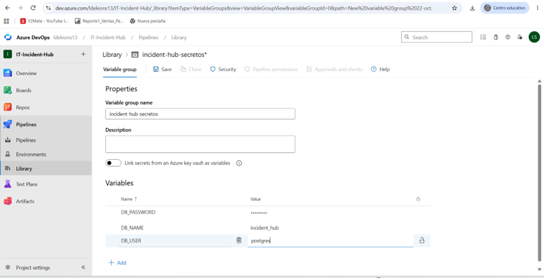
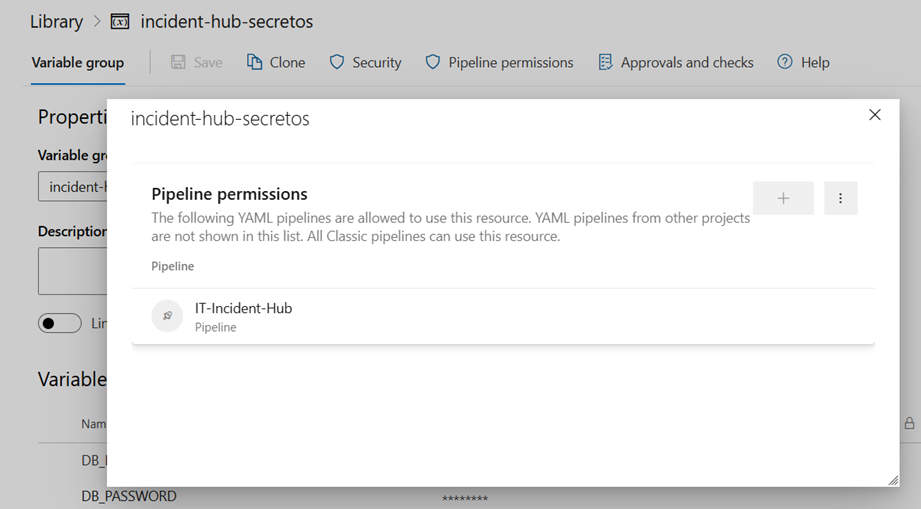
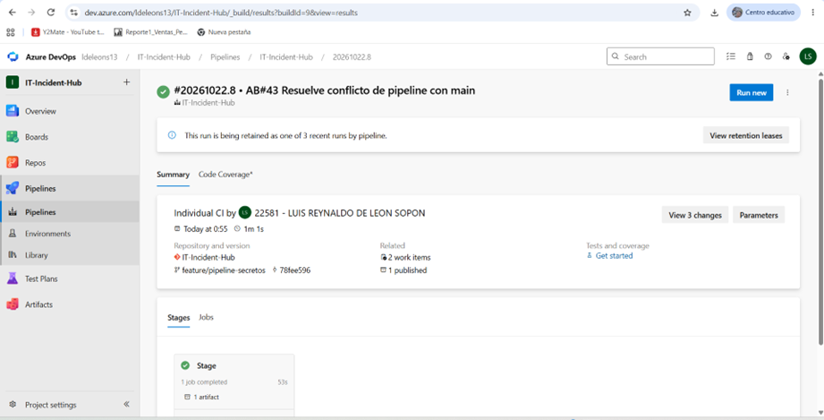
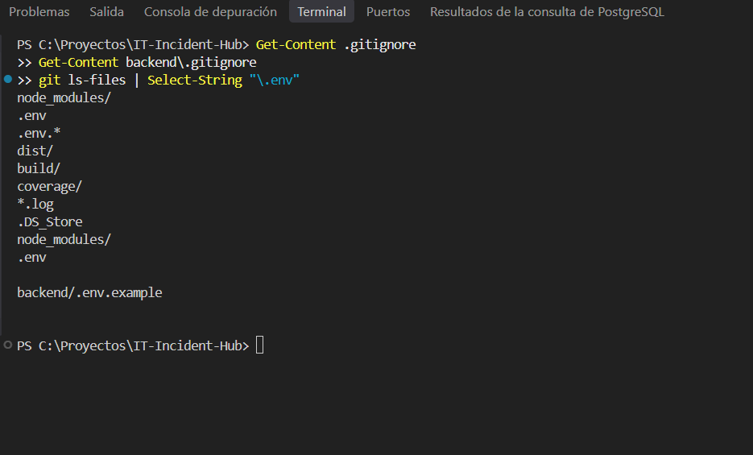

# Seguridad

## 1. Gestión de secretos

Ninguna credencial, token o clave se guarda en el repositorio.

| Secreto | Dónde vive | Cómo se protege |
|---------|-----------|-----------------|
| Contraseña de PostgreSQL (local) | `backend/.env` | Ignorado por `.gitignore`; solo se versiona `backend/.env.example` con un valor ficticio |
| `DB_PASSWORD` en el pipeline | Variable Group `incident-hub-secretos` (Pipelines → Library) | Variable secreta: su valor se muestra enmascarado y Azure lo oculta en los logs |
| Token de acceso (PAT) del agente | Solo en la configuración local del agente | Permiso mínimo (Agent Pools), expiración corta; nunca se escribió en el repositorio |

## 2. Acceso del pipeline al secreto

Solo el pipeline `IT-Incident-Hub` tiene permiso para usar el Variable Group.

## 3. Uso del secreto en el pipeline

El secreto no pasa solo al entorno: se asigna explícitamente en el paso "Verificar secreto protegido", que imprime únicamente la longitud, nunca el valor. La ejecución con ese paso terminó en verde.

## 4. El repositorio no contiene secretos

- `.gitignore` excluye `.env` y `.env.*`, con la excepción `!.env.example` para versionar plantillas.
- Comprobación: `git ls-files | Select-String "\.env"` solo muestra plantillas `.env.example`, nunca un `.env` real.

## 5. El artefacto no contiene secretos

El paquete publicado excluye `node_modules` y `.env`. Se descargó el `.zip` y se verificó que `backend/` incluye únicamente `.env.example`.

## 6. Control de cambios

- `main` exige 1 revisor distinto del autor y un Work Item vinculado.
- El pipeline audita las dependencias de producción (ver `docs/dependencias.md`).

## 7. Riesgos conocidos

- La aplicación aún no tiene autenticación ni autorización (DT-4, ver `docs/deuda-tecnica.md`).
- El agente muestra una advertencia SSL de telemetría, ajena al código, que no afecta el resultado.